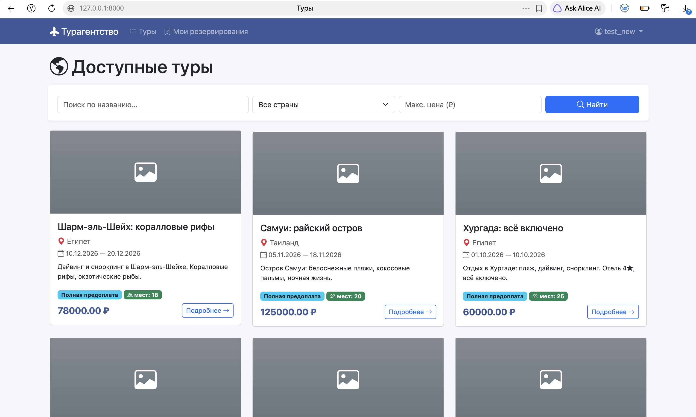
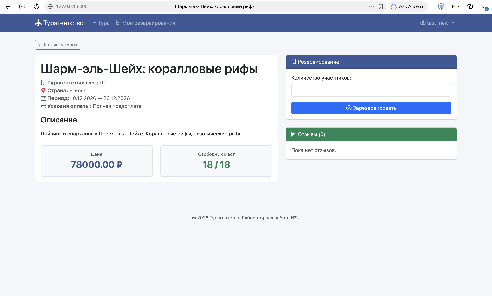
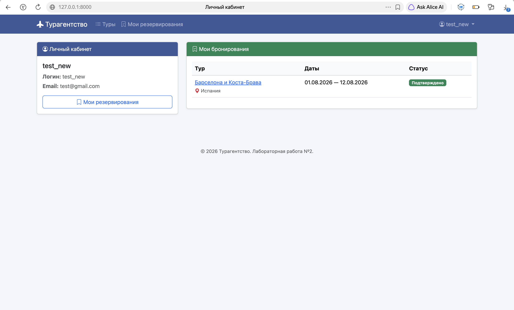
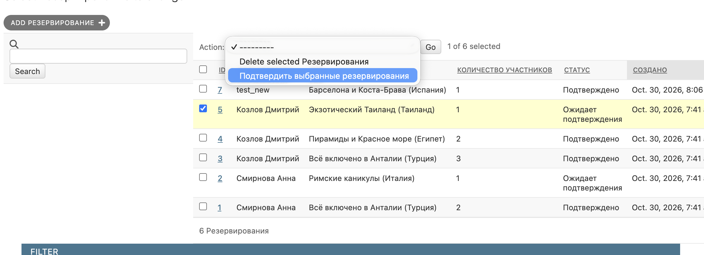
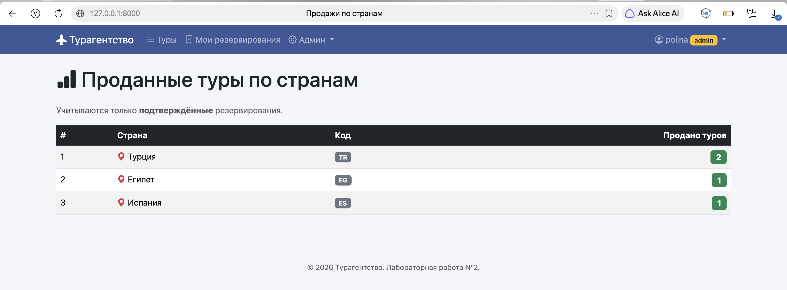
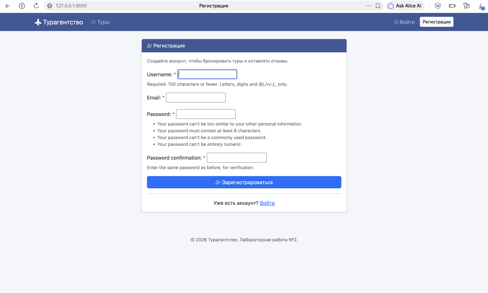

# Лабораторная работа №2. Простой сайт на Django

**Вариант 4 — Список туров туристической фирмы**

---

## Цель работы

Овладеть практическими навыками реализации web-сервисов средствами Django, изучить паттерн MVC (MVT), работу с ORM, формами, шаблонами и разграничением прав доступа.

---

## 1. Модель данных

В проекте используется **PostgreSQL**. Схема БД состоит из **5 моделей**:

| Модель | Описание | Ключевые поля | Связи |
|--------|----------|---------------|-------|
| **Country** | Справочник стран | `name`, `code` | — |
| **TourAgency** | Турагентства | `name`, `address`, `phone`, `email` | — |
| **Tour** | Туры | `name`, `description`, `start_date`, `end_date`, `price`, `payment_terms` (choices), `max_participants` | `FK → TourAgency`, `FK → Country` |
| **Reservation** | Резервирования | `participants_count`, `status` (pending / confirmed / cancelled), `created_at` | `FK → User`, `FK → Tour` |
| **Review** | Отзывы | `text`, `rating` (1–10), `created_at` | `FK → User`, `FK → Tour` |

### ER-диаграмма (текстовая)

```
Country ──1:N──> Tour <──N:1── TourAgency
                  │
                  ├──1:N──> Reservation <──N:1── User (AUTH_USER_MODEL)
                  └──1:N──> Review <────N:1──── User
```

!!! note "Промежуточные модели"
    Связь «многие ко многим» между `User` и `Tour` (через `Reservation`) реализована **явной промежуточной моделью**, так как бронь имеет **свои атрибуты** (количество человек, статус, дата создания).

---

## 2. Ключевые Views (контроллеры)

Реализованы как **CBV** (Class-Based Views), так и **FBV** (Function-Based Views).

| View | Тип | Описание |
|------|-----|----------|
| `TourListView` | CBV (`ListView`) | Список туров с **пагинацией** (по 6) и **фильтрацией** (поиск, страна, цена) |
| `TourDetailView` | CBV (`DetailView`) | Детальная страница тура с отзывами и формой бронирования |
| `reserve_tour` | FBV | POST-обработчик бронирования (проверка мест) |
| `ReservationListView` | CBV (`LoginRequiredMixin`) | Личный кабинет — только **свои** брони |
| `ReservationUpdateView` | CBV (`UserPassesTestMixin`) | Редактирование брони (только **pending** и **свои**) |
| `ReservationDeleteView` | CBV (`UserPassesTestMixin`) | Удаление **своей** брони |
| `add_review` | FBV | Отзыв (только после **confirmed** брони) |
| `TourCreateView`, `TourUpdateView`, `TourDeleteView` | CBV (`UserPassesTestMixin` — `is_staff`) | CRUD туров — **только админ** |
| `SoldToursByCountryView` | CBV (`UserPassesTestMixin` — `is_staff`) | Отчёт по странам (только **confirmed**) |

### Пример: пагинация и фильтрация

```python
class TourListView(ListView):
    model = Tour
    template_name = 'tours/tour_list.html'
    context_object_name = 'tours'
    paginate_by = 6

    def get_queryset(self):
        qs = Tour.objects.select_related('country', 'agency')
        q = self.request.GET.get('q')
        if q:
            qs = qs.filter(Q(name__icontains=q) | Q(description__icontains=q))
        country = self.request.GET.get('country')
        if country and country.isdigit() and int(country) > 0:
            qs = qs.filter(country_id=int(country))
        max_price = self.request.GET.get('max_price')
        if max_price:
            try:
                qs = qs.filter(price__lte=float(max_price))
            except ValueError:
                pass
        return qs
```

---

## 3. Ключевые шаблоны

| Шаблон | Назначение |
|--------|------------|
| `base.html` | Базовый каркас с навигацией и **проверкой `user.is_staff`** |
| `tour_list.html` | Сетка карточек туров + форма фильтрации + пагинация |
| `tour_detail.html` | Детали тура + отзывы + форма брони |
| `reservation_list.html` | Таблица личных броней |
| `sold_tours.html` | Таблица продаж по странам (только админ) |

### Разграничение прав в шаблоне (`base.html`)

```django

<li class="nav-item dropdown">
    <a class="nav-link dropdown-toggle" data-bs-toggle="dropdown">
        Админ
    </a>
    <ul class="dropdown-menu">
        <li><a href="">Добавить тур</a></li>
        <li><a href="">Продажи по странам</a></li>
    </ul>
</li>

```

---

## 4. Разграничение прав доступа

| Роль | Возможности |
|------|-------------|
| **Обычный пользователь** | Просмотр туров, бронирование, **редактирование/удаление своих** броней, отзывы (после подтверждения) |
| **Администратор (`is_staff`)** | Всё вышеперечисленное + CRUD туров через интерфейс сайта + отчёт `/sold-tours/` + подтверждение броней в Django-admin |

!!! warning "Разграничение на клиенте"
    Проверка `` в шаблонах **скрывает** элементы управления. Попытка прямого доступа через URL → **403 Forbidden** (защита `UserPassesTestMixin`).

---

## 5. Скриншоты работы

### 5.1. Список туров с фильтрацией и пагинацией



### 5.2. Детальная страница тура



### 5.3. Личный кабинет и бронирования



### 5.4. Подтверждение броней в Django-admin



### 5.5. Отчёт «Продажи по странам»



### 5.6. Регистрация (без паспортных данных для туров)



---

## 6. Выводы

В ходе работы реализован **полноценный web-сервис** на Django + PostgreSQL:

- Модель данных с **5 связанными сущностями** (FK, M:N через промежуточную модель).
- **CRUD** для всех основных сущностей (CBV: `ListView`, `DetailView`, `CreateView`, `UpdateView`, `DeleteView`).
- **Формы** на основе `ModelForm` (`ReservationForm`, `ReviewForm`, `TourForm`).
- **Разграничение прав** (`is_staff`) и на клиенте, и на сервере.
- **Пагинация** (по 6) и **фильтрация** (поиск, страна, цена).
- **Django-admin** для модерации броней (mass action «Подтвердить»).
- **UI** на **Bootstrap 5** с кастомной палитрой.
